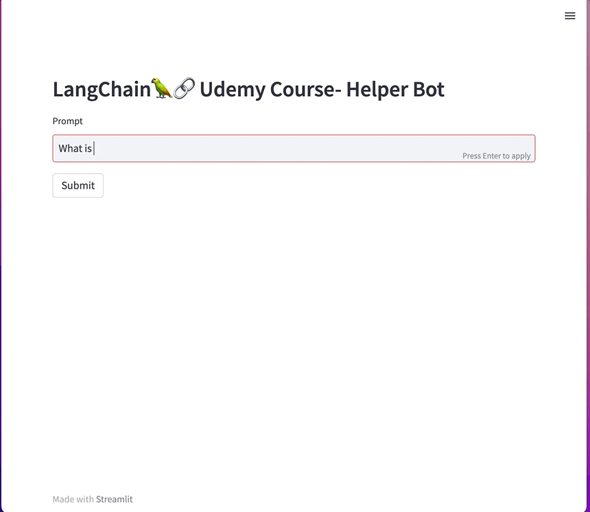
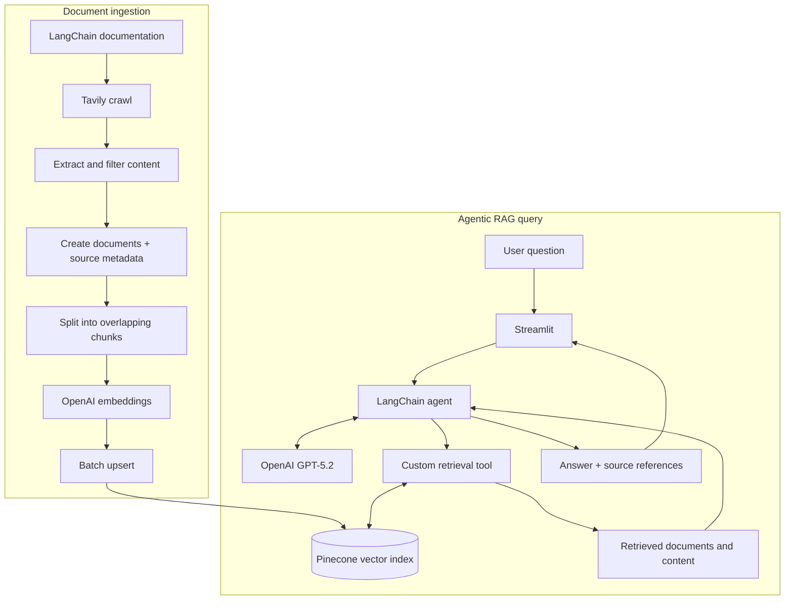

# 🧭 LangChain-Navigator

**An agentic RAG documentation assistant built with Python, LangChain, OpenAI, Pinecone, and Tavily.**

LangChain-Navigator turns technical documentation into a searchable knowledge base. It crawls documentation, processes and embeds page content, stores vectors in Pinecone, and uses a LangChain agent with a custom retrieval tool to answer questions with supporting source references.

<p align="center">
  
</p>

<p align="center">
  
  
  
  
  
  
</p>

## 📌 Overview

This project demonstrates an end-to-end **Retrieval-Augmented Generation (RAG)** workflow—from acquiring web content to serving LLM responses through an interactive application.

### Key capabilities

- **Documentation crawling:** Collect pages from the LangChain documentation site with Tavily.
- **Content preparation:** Filter empty content, create documents with source URL metadata, and split text into overlapping chunks.
- **Embedding and indexing:** Generate vectors using OpenAI `text-embedding-3-small` and store them in Pinecone.
- **Agentic retrieval:** Provide a custom LangChain tool for searching the indexed documentation.
- **Grounded answers:** Guide the agent to use retrieved context, cite sources, and acknowledge when context is insufficient.
- **Interactive chat:** Ask questions in a Streamlit interface and inspect source references.

## 🏗️ Architecture

The system has two workflows: a batch ingestion pipeline and an interactive query pipeline.



### Data flow

| Stage | Implementation | Purpose |
|---|---|---|
| Crawl | Tavily `TavilyCrawl` | Retrieve documentation pages |
| Transform | Python + `RecursiveCharacterTextSplitter` | Filter content and create overlapping chunks |
| Embed | OpenAI `text-embedding-3-small` | Convert text chunks into vectors |
| Store | Pinecone `PineconeVectorStore` | Persist vectors for semantic retrieval |
| Orchestrate | LangChain agent | Decide when to use the retrieval tool |
| Retrieve | Custom LangChain `@tool` | Find relevant documentation context |
| Present | Streamlit | Display answers and source references |

## 🛠️ Tech stack

| Component | Technology |
|---|---|
| Language | Python |
| Agent framework | LangChain |
| LLM | OpenAI GPT-5.2 |
| Embedding model | OpenAI `text-embedding-3-small` |
| Vector database | Pinecone |
| Web crawling | Tavily |
| Text splitting | LangChain text splitters |
| UI | Streamlit |
| Configuration | `python-dotenv` |

## ⚙️ Technical implementation

### 1. Ingestion pipeline — `ingestion.py`

1. Crawl `https://python.langchain.com/` using Tavily with a configured crawl depth.
2. Extract page content and skip empty results.
3. Store source URLs in LangChain document metadata.
4. Split content into chunks using `RecursiveCharacterTextSplitter`.
5. Generate embeddings and index chunks in Pinecone in batches.

| Setting | Value |
|---|---:|
| Crawl depth | 2 |
| Chunk size | 4,000 characters |
| Chunk overlap | 200 characters |
| Indexing batch size | 500 |
| Index name | `langchain-doc-index` |
| Embedding model | `text-embedding-3-small` |

### 2. Agent and retrieval — `backend/core.py`

- A custom decorated `@tool` exposes documentation retrieval to the agent.
- The agent uses OpenAI GPT-5.2 and can call the retrieval tool to gather context.
- Retrieved content is supplied to the model, while document artifacts can support source presentation.
- The system prompt instructs the agent to ground answers in documentation and acknowledge insufficient evidence.

### 3. Vector search — Pinecone

The ingestion and query paths use OpenAI `text-embedding-3-small`. Its default output is **1,536 dimensions**, so the Pinecone index should use the matching dimension and a compatible similarity metric such as cosine.

**Important:** the current ingestion flow clears existing vectors before re-indexing. This is a destructive operation. Use a dedicated index for this project and do not share it with unrelated data.

### 4. Streamlit interface — `main.py`

The UI accepts questions, displays agent responses, handles errors, manages displayed chat messages in session state, and presents source references in expandable sections.

## 📁 Project structure

```text
LangChain-Navigator/
├── backend/
│   ├── __init__.py
│   └── core.py           # Agent, retrieval tool, and LLM call
├── static/               # Demo animation and logo assets
├── main.py               # Streamlit chat application
├── ingestion.py          # Crawl, process, embed, and index
├── consts.py             # Configuration constants
├── logger.py             # Logging utilities
└── README.md
```

The repository also includes Tavily tutorial notebooks and may contain local development artifacts.

## 🚀 Setup and execution

### Prerequisites

- Python 3.10+ (confirm compatibility with the installed package versions)
- OpenAI API key
- Pinecone API key and index
- Tavily API key

### 1. Clone the repository

```bash
git clone https://github.com/MuhammadMudassirRaza12345/LangChain-Navigator.git
cd LangChain-Navigator
```

### 2. Create a virtual environment

```bash
python -m venv .venv
```

Activate it:

```bash
# macOS / Linux
source .venv/bin/activate

# Windows PowerShell
.\.venv\Scripts\Activate.ps1
```

### 3. Install dependencies

Install the dependencies listed in the dependency manifest maintained in the repository. If using a `Pipfile`, install Pipenv and run:

```bash
pip install pipenv
pipenv install
pipenv shell
```

If you maintain a `requirements.txt` instead, use:

```bash
pip install -r requirements.txt
```

### 4. Configure environment variables

Create a `.env` file in the project root:

```dotenv
OPENAI_API_KEY=your_openai_api_key
PINECONE_API_KEY=your_pinecone_api_key
TAVILY_API_KEY=your_tavily_api_key
```

Keep credentials private and never commit your `.env` file.

### 5. Configure Pinecone

Create a dense index named `langchain-doc-index` with **1,536 dimensions** and **cosine** similarity. Use an index dedicated to this project because ingestion clears existing vectors during a full re-index.

### 6. Ingest documentation

```bash
python ingestion.py
```

Wait for ingestion to complete before querying the application. Crawling and embedding may consume API quota and incur usage costs.

### 7. Run the app

```bash
streamlit run main.py
```

Open the local URL shown in the terminal, typically `http://localhost:8501`.

## 💬 Example questions

- How do I create a custom tool in LangChain?
- How can an agent invoke a retrieval tool?
- How does a vector store support a RAG workflow?
- What is the role of a document loader versus a text splitter?

The answers depend on the content successfully crawled and indexed.

## 🧠 Engineering skills demonstrated

- **Data engineering:** web ingestion, filtering, chunking, metadata preservation, batch indexing.
- **API integration:** connecting Tavily, OpenAI, and Pinecone.
- **RAG systems:** embeddings, vector search, context retrieval, and grounded generation.
- **Agentic AI:** LangChain agent orchestration with a custom retrieval tool.
- **Python application development:** modular backend logic and Streamlit UI.
- **Operational awareness:** logging, API usage, credential configuration, and destructive re-indexing considerations.

## 🗺️ Potential improvements

- [ ] Add conversational memory for multi-turn follow-up questions.
- [ ] Add automated tests for ingestion, retrieval, and response handling.
- [ ] Evaluate retrieval quality and answer faithfulness.
- [ ] Add safer incremental indexing and ingestion checkpoints.
- [ ] Add Docker deployment and reproducible dependency versions.
- [ ] Add observability for ingestion and retrieval.

## 🙏 Acknowledgements

This project was developed while learning from Eden Marco's [LangChain course](https://www.udemy.com/course/langchain/), with additional implementation and customization.

## 👤 Author

**Muhammad Mudassir Raza**  
Data Engineering · AI · Cloud

- GitHub: [MuhammadMudassirRaza12345](https://github.com/MuhammadMudassirRaza12345)
- LinkedIn: [Muhammad Mudassir Raza](https://www.linkedin.com/in/muhammadmudassirraza/)
- Portfolio: [View Portfolio](https://muhammadmudassirraza12345.github.io/My_Portfolio/)

---

*Built to explore the engineering foundations of documentation ingestion, semantic retrieval, and agentic AI applications.*
