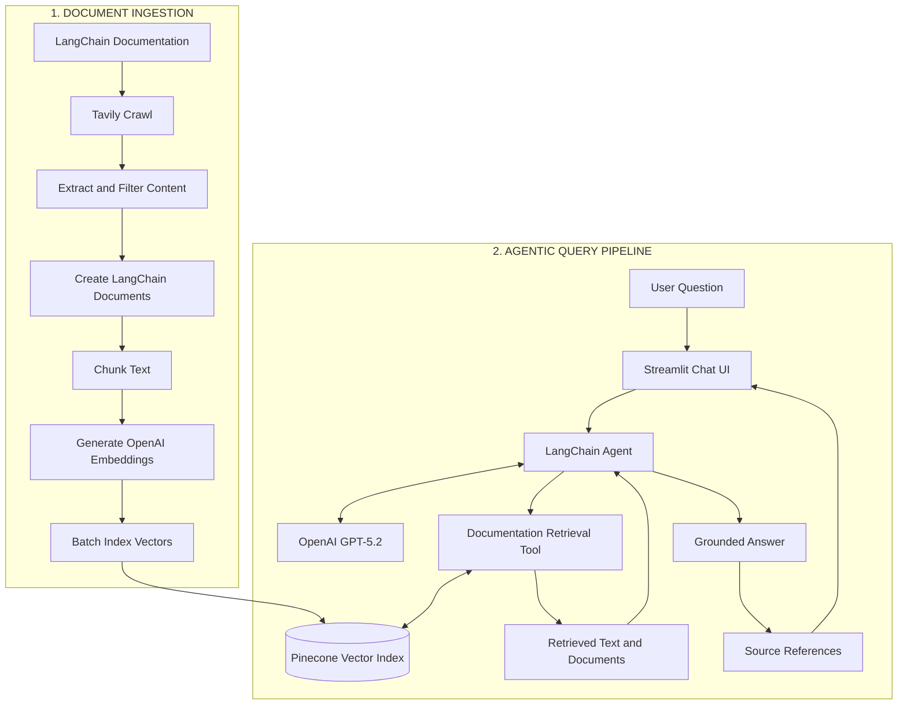

<!-- 
# 🦜 LangChain Documentation Helper

<div align="center">

**An intelligent documentation assistant powered by LangChain and vector search**

<p align="center">
  
  
</p>

<br>

[](https://www.python.org/downloads/)
[](https://langchain.com/)
[](https://streamlit.io/)
[](https://pinecone.io/)
[](https://app.tavily.com/home?utm_campaign=eden_marco&utm_medium=socials&utm_source=linkedin)
[](LICENSE)

[](https://www.udemy.com/course/langchain/?couponCode=APRIL-2026)

</div>

## 🎯 Overview

The **LangChain Documentation Helper** is a sophisticated AI-powered web application that serves as a slim version of [chat.langchain.com](https://chat.langchain.com/). This intelligent documentation assistant provides accurate answers to questions about LangChain documentation using advanced Retrieval-Augmented Generation (RAG) techniques, enhanced with web crawling capabilities and conversational memory.

### ✨ Key Features

**RAG Pipeline Flow:**

1. 🌐 **Web Crawling**: Real-time web scraping and content extraction using Tavily's advanced crawling capabilities
2. 📚 **Document Processing**: Intelligent chunking and preprocessing of LangChain documentation
3. 🔍 **Vector Storage**: Advanced embedding and indexing using Pinecone for fast similarity search
4. 🎯 **Intelligent Retrieval**: Context-aware document retrieval based on user queries
5. 🧩 **Memory System**: Conversational memory for coreference resolution and context continuity
6. 🧠 **Context-Aware Generation**: Provides accurate, contextual answers with source citations
7. 💬 **Interactive Interface**: User-friendly chat interface powered by Streamlit
8. 🚀 **Real-time Processing**: Fast end-to-end pipeline from query to response

## 🎬 Demo

<div align="center">
  
  <p><em>Interactive demo showing the LangChain Documentation Helper in action</em></p>
</div>

## 🛠️ Tech Stack

<div align="center">

| Component | Technology | Description |
|-----------|------------|-------------|
| 🖥️ **Frontend** | Streamlit | Interactive web interface |
| 🧠 **AI Framework** | LangChain 🦜🔗 | Orchestrates the AI pipeline |
| 🔍 **Vector Database** | Pinecone 🌲 | Stores and retrieves document embeddings |
| 🌐 **Web Crawling** | Tavily | Intelligent web scraping and content extraction |
| 🧩 **Memory** | Conversational Memory | Coreference resolution and context continuity |
| 🤖 **LLM** | OpenAI GPT | Powers the conversational AI |
| 🐍 **Backend** | Python | Core application logic |

</div>

## 🚀 Quick Start

### Prerequisites

- Python 3.8 or higher
- OpenAI API key
- Pinecone API key
- [Tavily API key](https://app.tavily.com/home?utm_campaign=eden_marco&utm_medium=socials&utm_source=linkedin) (required - for documentation crawling and web search)

### Installation

1. **Clone the repository**
   ```bash
   git clone https://github.com/emarco177/documentation-helper.git
   cd documentation-helper
   ```

2. **Set up environment variables**
   
   Create a `.env` file in the root directory:
   ```env
   PINECONE_API_KEY=your_pinecone_api_key_here
   OPENAI_API_KEY=your_openai_api_key_here
   TAVILY_API_KEY=your_tavily_api_key_here  # Required - for documentation crawling
   ```

3. **Install dependencies**
   ```bash
   pipenv install
   ```

4. **Ingest LangChain Documentation** (Run the ingestion pipeline)
   ```bash
   python ingestion.py  # Uses Tavily to crawl and index documentation
   ```

5. **Run the application**
   ```bash
   streamlit run main.py
   ```

6. **Open your browser** and navigate to `http://localhost:8501`

## 🧪 Testing

Run the test suite to ensure everything is working correctly:

```bash
pipenv run pytest .
```

## 📁 Project Structure

```
documentation-helper/
├── backend/                          # Core backend logic
│   ├── __init__.py
│   └── core.py
├── static/                           # Static assets (images, logos)
│   ├── banner.gif
│   ├── LangChain Logo.png
│   ├── Tavily Logo.png
│   ├── Tavily Logo Trimmed Padded.png
│   └── Trimmed Padded Langchain.png
├── chroma_db/                        # Local vector database
├── main.py                           # Streamlit application entry point
├── ingestion.py                      # Document ingestion pipeline
├── consts.py                         # Configuration constants
├── logger.py                         # Logging utilities
├── Tavily Demo Tutorial.ipynb        # 📚 Tutorial: Introduction to Tavily API
├── Tavily Crawl Demo Tutorial.ipynb  # 📚 Tutorial: Advanced Tavily crawling techniques
└── requirements files                # Pipfile, Pipfile.lock
```

### 📚 Tutorial Notebooks

The project includes comprehensive Jupyter notebooks that serve as hands-on tutorials:

- **`Tavily Demo Tutorial.ipynb`**: Introduction to Tavily API basics and core functionality
- **`Tavily Crawl Demo Tutorial.ipynb`**: Advanced tutorial covering Tavily's crawling capabilities, including TavilyMap and TavilyExtract features

These tutorials provide step-by-step guidance on integrating Tavily's powerful web search and crawling capabilities into your AI applications.

## 🔧 Configuration

### Environment Variables

| Variable | Description | Required |
|----------|-------------|----------|
| `PINECONE_API_KEY` | Your Pinecone API key for vector storage | ✅ |
| `OPENAI_API_KEY` | Your OpenAI API key for LLM access | ✅ |
| `TAVILY_API_KEY` | Your Tavily API key for documentation crawling and web search | ✅ |

## 🤝 Contributing

Contributions are welcome! Please feel free to submit a Pull Request. For major changes, please open an issue first to discuss what you would like to change.

## 📚 Learning Resources

This project is designed as a learning tool for understanding:
- 🦜 LangChain framework implementation
- 🔍 Vector search and embeddings
- 💬 Conversational AI development
- 🏗️ RAG (Retrieval-Augmented Generation) architecture

## 📄 License

This project is licensed under the MIT License - see the [LICENSE](LICENSE) file for details.

## 🌟 Support

If you find this project helpful, please consider:
- ⭐ Starring the repository
- 🐛 Reporting issues
- 💡 Contributing improvements
- 📢 Sharing with others

---

<div align="center">

### 🔗 Connect with Me

[](https://www.udemy.com/course/langchain/?referralCode=D981B8213164A3EA91AC)
[](https://www.linkedin.com/in/eden-marco/)
[](https://twitter.com/EdenEmarco177)

**Built with ❤️ by Eden Marco**

</div> -->

# 🧭 LangChain-Navigator

**An agentic RAG documentation assistant built with Python, LangChain, OpenAI, Pinecone, and Tavily.**

Turn technical documentation into a searchable knowledge base and use an AI agent to retrieve relevant context, generate grounded answers, and present source references.

<p align="center">
  
  &nbsp;&nbsp;&nbsp;
  
</p>

<p align="center">
  
  
  
  
  
  
</p>

<p align="center">
  <a href="#-demo">Demo</a> ·
  <a href="#-architecture">Architecture</a> ·
  <a href="#-technical-implementation">Technical Implementation</a> ·
  <a href="#-setup-and-execution">Setup</a> ·
  <a href="#-engineering-skills-demonstrated">Skills</a>
</p>

---

## 📌 Overview

LangChain-Navigator is an end-to-end **Retrieval-Augmented Generation (RAG)** application that combines document ingestion, vector search, and agentic AI to answer questions about the official LangChain documentation.

Rather than relying exclusively on an LLM's pre-trained knowledge, the application retrieves relevant documentation from a Pinecone vector index and provides that context to a tool-calling LangChain agent.

The project demonstrates how to connect data acquisition, text processing, embedding generation, vector storage, retrieval, LLM orchestration, and a user-facing application into one workflow.

### Key capabilities

- **Automated documentation ingestion:** Crawl the LangChain documentation website using Tavily.
- **Document processing:** Filter empty content and split extracted text into overlapping chunks.
- **Semantic search:** Generate embeddings with OpenAI and store vectors in Pinecone.
- **Agentic retrieval:** Expose documentation search as a tool that the LangChain agent can invoke.
- **Grounded responses:** Instruct the agent to use retrieved documentation and acknowledge when the available context is insufficient.
- **Source presentation:** Display supporting document references alongside answers.
- **Interactive application:** Explore documentation through a Streamlit chat interface.

## 🎬 Demo

<p align="center">
  
</p>

## 🏗 Architecture

The application consists of two main workflows: an offline ingestion pipeline and an interactive query pipeline.



### Pipeline breakdown

| Stage | Responsibility | Implementation |
|---|---|---|
| Crawl | Acquire documentation content | Tavily `TavilyCrawl` |
| Extract and clean | Extract page content and skip empty results | Python filtering and logging |
| Transform | Split documents into overlapping chunks | `RecursiveCharacterTextSplitter` |
| Embed | Convert document chunks into vectors | OpenAI `text-embedding-3-small` |
| Store | Persist vectors for semantic retrieval | `PineconeVectorStore` |
| Orchestrate | Coordinate LLM responses and tool calls | LangChain `create_agent` |
| Retrieve | Search indexed documentation for relevant context | Custom `@tool` retrieval function |
| Present | Display answers and source references | Streamlit |

## 🛠 Tech Stack

| Layer | Technology | Purpose |
|---|---|---|
| Programming language | Python | Pipeline implementation and application logic |
| Agent framework | LangChain | Agent orchestration, tool calling, and model integration |
| LLM | OpenAI GPT-5.2 | Answer generation and tool-use decisions |
| Embeddings | OpenAI `text-embedding-3-small` | Semantic representation of document chunks and queries |
| Vector database | Pinecone | Vector storage and similarity search |
| Web crawling | Tavily | Documentation discovery and content extraction |
| Text processing | LangChain text splitters | Document chunking and overlap management |
| Frontend | Streamlit | Interactive chat application |
| Configuration | `python-dotenv` | Environment-based API key configuration |
| Networking | `certifi` | SSL certificate bundle support |

## ⚙️ Technical Implementation

### 1. Document ingestion and preprocessing

Implemented in `ingestion.py`.

The ingestion pipeline transforms a documentation website into a searchable vector knowledge base.

1. Crawl the official LangChain documentation website using Tavily.
2. Extract available page content and skip pages with empty content.
3. Create LangChain `Document` objects with source URL metadata.
4. Split documents into chunks using `RecursiveCharacterTextSplitter`.
5. Generate embeddings using OpenAI's `text-embedding-3-small` model.
6. Upload document chunks to Pinecone in batches.

**Chunking configuration**

| Parameter | Value |
|---|---:|
| Chunk size | 4,000 |
| Chunk overlap | 200 |
| Embedding model | `text-embedding-3-small` |
| Index name | `langchain-doc-index` |
| Indexing batch size | 500 |

The chunk overlap helps retain contextual continuity between adjacent text segments. Source metadata supports traceability from retrieved content back to its originating documentation page.

### 2. Agentic RAG and tool calling

Implemented in `backend/core.py`.

The query pipeline uses a LangChain agent rather than a purely fixed retrieval chain.

- **Custom retrieval tool:** Documentation search is exposed through a decorated `@tool` function.
- **Agent-controlled retrieval:** The agent can invoke the tool to obtain documentation relevant to a user's question.
- **Context-grounded generation:** Retrieved text is provided to the model to support its answer.
- **Source preservation:** The retrieval tool returns serialized content for the LLM and document objects as an artifact for downstream source presentation.
- **Response separation:** The `run_llm()` interface separates answer generation from the Streamlit presentation layer.

The system prompt guides the agent to consult the documentation, reference its sources, and acknowledge when the retrieved information does not answer the question.

### 3. Vector search with Pinecone

Pinecone provides the persistent vector index used by the ingestion and query pipelines.

The embedding model must remain compatible between ingestion and retrieval. The default `text-embedding-3-small` configuration produces **1,536-dimensional vectors**, so the Pinecone index must use the corresponding dimension.

The ingestion code also includes a full re-indexing operation that clears existing vectors before ingesting fresh documentation. This is a destructive operation: it deletes vectors in the configured index, so use a dedicated development index and do not share it with unrelated workloads.

### 4. Interactive application

Implemented in `main.py`.

The Streamlit interface provides:

- A chat input for documentation questions.
- Session-state handling for displayed conversation messages.
- A loading indicator while the agent processes a request.
- Error handling around agent execution.
- Expandable source references for answers.
- A control to clear the displayed chat.

This separates the user interface from the underlying retrieval and agent implementation.

### 5. Configuration and operational considerations

The project uses environment variables for service credentials and a dedicated ingestion script to build the knowledge base.

Operational considerations include:

- API credentials should be kept out of source control.
- Crawling and embedding consume API quota and may incur usage costs.
- Large ingestion runs should be monitored for failures and incomplete indexing.
- Re-indexing should be performed with awareness of its effect on existing vectors.
- Dependency versions should be tested and pinned for reproducible deployments.

## 📁 Project Structure

```text
LangChain-Navigator/
├── backend/
│   ├── __init__.py
│   └── core.py           # Agent, retrieval tool, and run_llm()
├── static/
│   ├── banner.gif        # Demo animation
│   ├── Trimmed Padded Langchain.png
│   └── Tavily Logo Trimmed Padded.png
├── main.py               # Streamlit chat application
├── ingestion.py          # Crawl, process, embed, and index
├── consts.py             # Shared configuration constants
├── logger.py             # Logging utilities
└── README.md
```

*Additional notebooks or local development artifacts may also be present in the repository.*

## 🚀 Setup and Execution

### Prerequisites

- Python 3.10 or a compatible version supported by your installed dependencies.
- An OpenAI API key.
- A Pinecone API key and a configured index.
- A Tavily API key.
- Git.

### 1. Clone the repository

```bash
git clone https://github.com/MuhammadMudassirRaza12345/LangChain-Navigator.git
cd LangChain-Navigator
```

### 2. Create a virtual environment

```bash
python -m venv .venv
```

Activate it:

```bash
# macOS / Linux
source .venv/bin/activate
```

```powershell
# Windows PowerShell
.\.venv\Scripts\Activate.ps1
```

### 3. Install dependencies

If the repository contains a `requirements.txt` file, install its dependencies:

```bash
pip install -r requirements.txt
```

Otherwise, install the packages used by the application and its imports, then verify compatibility with the code:

```bash
pip install streamlit python-dotenv certifi langchain langchain-core langchain-openai langchain-pinecone langchain-tavily langchain-text-splitters
```

### 4. Configure API credentials

Create a `.env` file in the project root:

```dotenv
OPENAI_API_KEY=your_openai_api_key
PINECONE_API_KEY=your_pinecone_api_key
TAVILY_API_KEY=your_tavily_api_key
```

Replace the placeholder values with your actual credentials. Never commit `.env` or expose API keys in screenshots, logs, or public repositories.

### 5. Create the Pinecone index

In your Pinecone project, create a **dense vector index** with these settings:

| Setting | Value |
|---|---|
| Index name | `langchain-doc-index` |
| Dimensions | `1536` |
| Similarity metric | `cosine` |

Use an index dedicated to this application because the ingestion pipeline clears existing vectors during a full re-index.

### 6. Build the documentation knowledge base

Run the ingestion pipeline:

```bash
python ingestion.py
```

The script crawls the configured documentation website, processes the extracted content, generates embeddings, and indexes the resulting document chunks.

Wait for ingestion to finish before asking questions in the application.

### 7. Launch the application

```bash
streamlit run main.py
```

Open the local URL shown in the terminal, usually:

```text
http://localhost:8501
```

## 🧪 Example Questions

Once ingestion is complete, try questions about the indexed LangChain documentation:

- How do I create a custom tool in LangChain?
- How does an agent invoke a retrieval tool?
- How can I connect a vector store to a retrieval workflow?
- What is the difference between a document loader and a text splitter?

Answers depend on the content successfully crawled and indexed, the retrieval results, and the model's response.

## 🧠 Engineering Skills Demonstrated

| Skill area | Demonstrated implementation |
|---|---|
| Data engineering | End-to-end ingestion from web content to a searchable vector index |
| Data transformation | Content filtering, document creation, chunking, and metadata preservation |
| API integration | Integration with Tavily, OpenAI, and Pinecone |
| Vector databases | Embedding storage and similarity-based retrieval |
| Agentic AI | LangChain agent orchestration with a custom tool |
| RAG architecture | Retrieval-grounded response generation and source presentation |
| Python development | Modular application and pipeline code |
| Application development | Streamlit UI connected to a separate backend |
| Configuration and security | Environment-based credential management |
| Operational awareness | Batch processing, logging, API usage, and re-indexing considerations |

## 🗺 Roadmap

Potential next steps for the project:

- [ ] Add conversational memory for multi-turn follow-up questions.
- [ ] Stream generated answers to the UI.
- [ ] Reuse the agent instance across requests where appropriate.
- [ ] Add automated tests for ingestion, retrieval, and response handling.
- [ ] Evaluate retrieval quality and answer faithfulness with a RAG evaluation framework.
- [ ] Add Docker-based deployment and a reproducible environment.
- [ ] Explore hybrid keyword and vector retrieval with optional re-ranking.
- [ ] Add ingestion checkpoints and safer incremental indexing.
- [ ] Add retrieval and ingestion observability for production-style monitoring.

## 🙏 Acknowledgements

This project was developed while learning from Eden Marco's [LangChain course](https://www.udemy.com/course/langchain/), with additional implementation and customization.

## 👤 Author

**Muhammad Mudassir Raza**

Data Engineering · AI · Cloud

- GitHub: [MuhammadMudassirRaza12345](https://github.com/MuhammadMudassirRaza12345)
- LinkedIn: [Muhammad Mudassir Raza](https://www.linkedin.com/in/muhammadmudassirraza/)
- Portfolio: [View Portfolio](https://muhammadmudassirraza12345.github.io/My_Portfolio/)

---

*Built to explore the engineering foundations of documentation ingestion, semantic retrieval, and agentic AI applications.*
